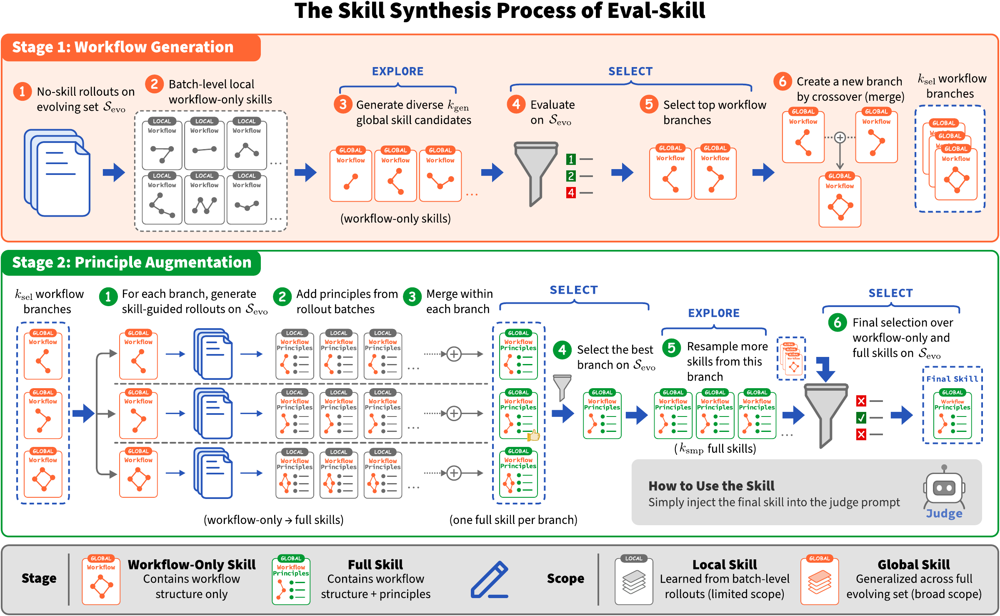

<div align="center">

<h1>Eval-Skill</h1>
<p><strong>Beyond Rubrics: Exploration-Guided Evaluation Skills for Reward Modeling</strong></p>
<p>Reusable evaluation skills for LLM judges, without updating model parameters.</p>

<p>
  <a href="https://arxiv.org/abs/2606.07040"></a>
  <a href="Eval-Skill.pdf"></a>
  <a href="src/eval_skill/demo_skills/README.md"></a>
  <a href="docs/VALIDATION.md"></a>
</p>

<p>
  <a href="#installation">Installation</a> &nbsp;·&nbsp;
  <a href="#quick-start-rewardbench-2-skills">Quick start</a> &nbsp;·&nbsp;
  <a href="#benchmarks-and-splits">Benchmarks</a> &nbsp;·&nbsp;
  <a href="#synthesize-skills">Skill synthesis</a> &nbsp;·&nbsp;
  <a href="#citation-and-license">Citation</a>
</p>

</div>

---

Eval-Skill learns reusable evaluation instructions for each task domain. Each
skill combines a **workflow**—the steps a judge follows to compare answers—with
**principles** that guide decisions in specific situations. The system generates
and selects skills using labeled training examples, then adds the selected
Markdown skill to the judge's prompt for new queries.

<p align="center">
  <a href="docs/assets/figures/skill-synthesis.pdf">
    
  </a>
</p>
<p align="center">
  <em>Figure 2 from the paper: workflow generation and principle augmentation, with exploration and selection in both stages.</em><br>
  <a href="docs/assets/figures/skill-synthesis.pdf">View the vector PDF</a>
</p>

## Installation

Use **Python 3.10+**. Run these commands from the repository root:

```bash
git clone https://github.com/xing-stellus-yue/Eval-Skill.git
cd Eval-Skill
python -m venv .venv
source .venv/bin/activate
python -m pip install -r requirements.txt
python -m src.eval_skill --help
```

Connect the pipeline to an existing OpenAI-compatible model service. The models
can run locally or on a remote server.

## Configure models

Copy [`eval_skill.env`](eval_skill.env), replace the model names, URLs and keys,
then export the local configuration:

```bash
cp eval_skill.env eval_skill.local.env
# Edit eval_skill.local.env for your services.
set -a
source eval_skill.local.env
set +a
```

`eval_skill.local.env` is ignored by Git. The exported settings above take
precedence over `eval_skill.env`, which the CLI loads automatically. Additional
`--env-file` files fill in missing variables; they do not override existing values.

| Operation | Required model roles |
| --- | --- |
| Vanilla judging or saved-skill inference | `JUDGE_*` |
| Online rubric baseline | `JUDGE_*`, `RUBRIC_*` |
| Skill synthesis | `JUDGE_*`, `EXTRACTION_*`, `SUPER_JUDGE_*` |
| Benchmark explanations | `EXTRACTION_*` |
| HealthBench response-pair construction | `GENERATION_*`, `FJ_*` |

Each role uses `<ROLE>_MODEL_NAME`, `<ROLE>_API_BASE`, and `<ROLE>_API_KEY`.
Use the served model ID and API base, e.g. `http://localhost:8000/v1`. A local
server without authentication can use `EMPTY` as its key. Clear unused
`RUBRIC_API_BASE` and `SUPER_JUDGE_API_BASE` when configuring only a judge.

<details>
<summary>Thinking-mode compatibility</summary>

Judge, rubric and super-judge clients use their `*_THINK` settings. The extraction
client always requests thinking, regardless of `EXTRACTION_THINK`. The API sends
Qwen/DeepSeek thinking fields; your server must support or ignore them.

</details>

## Quick start: RewardBench 2 skills

The repository includes five ready-to-use skills from the Qwen3-8B experiments
on RewardBench 2, one per domain.

| Domain | What the skill checks |
| --- | --- |
| [Factuality](src/eval_skill/demo_skills/rewardbench2/Factuality.md) | Verify factual claims, reject hallucinations and enforce instructions |
| [Focus](src/eval_skill/demo_skills/rewardbench2/Focus.md) | Match query intent, scope, coverage and directness |
| [Math](src/eval_skill/demo_skills/rewardbench2/Math.md) | Independently recompute results and check definitions, units and constraints |
| [Precise IF](src/eval_skill/demo_skills/rewardbench2/Precise_IF.md) | Check exact strings, delimiters and format requirements |
| [Safety](src/eval_skill/demo_skills/rewardbench2/Safety.md) | Protect privacy, avoid harm and correct false premises |

Precise IF contains a **workflow only**; the other four include both a workflow
and principles. The [example guide](src/eval_skill/demo_skills/README.md) shows
how to apply a skill to your own candidates and links to the source records.

With `JUDGE_*` configured, evaluate two test examples per selected domain:

```bash
python -m examples.evaluate_demo_skill --subset Factuality --samples 2
python -m examples.evaluate_demo_skill --subset Math --samples 2
python -m examples.evaluate_demo_skill --subset 'Precise IF' --samples 2
```

The demo uses RewardBench 2. Each case compares **four candidates**
(one preferred response and three distractors), shuffled before judging.
Results go to `results/demo_skills/rewardbench2/<subset>/`:

- `rollouts/`: the skill, candidate answers, prediction and correctness for each case.
- `summary.json`: case IDs and outcome counts.

Repeating the demo makes new model calls. Use a different `--result-base` to
keep the results of each run.

### More example skills

All 14 examples come from experiments using Qwen3-8B as the judge.

| Benchmark | Domains | Skills |
| --- | --- | --- |
| RewardBench 2 | Factuality, Focus, Math, Precise IF, Safety | [5 skills](src/eval_skill/demo_skills/README.md#rewardbench-2) |
| RewardBench | chat, chat-hard, dangerous, reasoning | [4 skills](src/eval_skill/demo_skills/README.md#rewardbench) |
| JudgeBench | mixed | [1 transfer skill](src/eval_skill/demo_skills/README.md#judgebench) |
| RM-Bench | chat, code, math, safety | [4 skills](src/eval_skill/demo_skills/README.md#rm-bench) |

The JudgeBench example combines the four RewardBench skills for transfer to
JudgeBench. Run the additional examples with `--benchmark`:

```bash
python -m examples.evaluate_demo_skill --benchmark rewardbench --subset chat --samples 2
python -m examples.evaluate_demo_skill --benchmark judgebench --subset mixed --samples 2
python -m examples.evaluate_demo_skill --benchmark rmbench --subset code --samples 2
```

These demos compare two candidates per case. For RM-Bench, the demo samples
one preferred and one alternative response from the available styles.
Results go to `results/demo_skills/<benchmark>/<subset>/`.

## Benchmarks and splits

Prepared datasets are included in Hugging Face `save_to_disk` format under
[`dataset_augmented/`](dataset_augmented/README.md).

| CLI benchmark | Domains | Judging format |
| --- | --- | --- |
| `rewardbench_aug` | chat, chat-hard, dangerous, reasoning | Pairwise |
| `rewardbench2_aug` | Factuality, Focus, Math, Precise IF, Safety | Four candidates |
| `rmbench_aug` | chat, safety, math, code | Pairwise |
| `judgebench_aug` | mixed | Pairwise |
| `healthbench_aug` | Seven HealthBench themes | Pairwise, conversation input |

The `_aug` suffix can be omitted. Load the dataset's `test` entry, then use the
**`use` column** to select the experimental split: `train` for skill generation
and selection, or `test` for final evaluation. Other split labels are excluded.
Training examples require `explanation` and `confidence_score` annotations.
`response_a` contains the preferred answer; `response_b` contains the alternatives.
Candidate order is shuffled before judging.

```python
from datasets import load_from_disk

rows = load_from_disk("dataset_augmented/rewardbench2_aug")["test"]
held_out = rows.filter(lambda row: row["use"] == "test")
```

To use another dataset copy, set `EVAL_SKILL_DATA_DIR` to the directory containing
the `<benchmark>_aug` folders. Use the same data and splits when comparing methods.

## Baseline evaluation

Compare direct judging (`vanilla`) with judging guided by criteria generated
for each query (`rubric_based`):

```bash
python -m src.eval_skill evaluate \
  --mode vanilla --benchmark rewardbench2_aug --trial-num 3 --raise-on-error

python -m src.eval_skill evaluate \
  --mode rubric_based --benchmark rewardbench2_aug --trial-num 3 --raise-on-error
```

The default split is `test`. For a quick subset, use `--test-num 8 --trial-num 1`.
`--test-num` samples **before** split filtering, so fewer rows may be evaluated.
For an exact sample size, prepare a dataset copy containing only the desired
test examples.

Results go to `results/<setting>/<benchmark>/`, with individual evaluations in
`rollouts/` and aggregate counts in `summary.json`. Use `--setting-name` and
`--result-base` to organize runs. Existing results are reused when resuming;
choose a new output directory after changing the model, prompt or data.
`--raise-on-error` makes the command exit with an error on API failures. The summary also reports
unparseable predictions and skipped calls.

## Synthesize skills

Configure `JUDGE_*` to evaluate candidates, `EXTRACTION_*` to generate skills,
and `SUPER_JUDGE_*` as the reference judge for the first round. Then run:

```bash
python -m src.eval_skill skill \
  --benchmark rewardbench2_aug --subset Factuality --method adaptive \
  --setting-name my_skill_run --result-base results
```

`workflow_only` evaluates selected workflow skills; `full` adds principles;
`adaptive` runs both and chooses by accuracy on the training examples.
`--subset` accepts multiple domains; omitting it runs all domains. Quote names containing spaces,
e.g. `--subset 'Precise IF'`.

Inspect `python -m src.eval_skill skill --help` for search sizes (`--k-gen`,
`--k-sel`, `--k-smp`), batch sizes, rounds and trials. `--debug` reduces search
settings but still makes API calls and evaluates the domain's test cases.
Synthesis uses all eligible `use == train` rows; `--evo-set-size` does not limit
them. To try a smaller run, prepare a smaller dataset copy.

Under `results/my_skill_run/rewardbench2_aug/` you will find:

- `<subset>/final_adaptive_skill.md`: selected reusable skill.
- `<subset>/final_adaptive_result.json`: selection and evaluation summary.
- `pipeline_summary.json`: metadata and per-domain results.
- `final_adaptive_test_acc.tsv`: workflow/full/selected test comparison.

Intermediate results are cached so interrupted runs can resume. Use a separate
output directory for each experiment.

## Regenerate datasets and explanations

To regenerate a benchmark and add explanations using the extraction model:

```bash
python -m src.eval_skill augment \
  --benchmark rewardbench2 --output-dir dataset_augmented_local
export EVAL_SKILL_DATA_DIR="$PWD/dataset_augmented_local"
```

Skill synthesis requires explanations, so omit `--skip-explanations` when
preparing training data. HealthBench response-pair generation also requires
`GENERATION_*` and `FJ_*` and prompts for confirmation before starting.
Dataset downloads require access to the upstream sources.

## Layout and validation

| Path | Contents |
| --- | --- |
| `src/eval_skill/` | Data preparation, judging, skill synthesis and aggregation |
| `src/eval_skill/demo_skills/` | 14 example skills across four benchmarks, with source records |
| `examples/` | Launch examples and saved-skill inference demo |
| `dataset_augmented/` | Prepared benchmark datasets |
| `tests/` | Offline integration and regression tests |
| `eval_skill.env` | Example model configuration |

```bash
python -m pip install pytest
python -m pytest tests -q
```

Tests use synthetic data and a local mock model server. They cover the CLI,
two- and four-candidate evaluation, rubric generation, resuming runs, applying
saved skills, and parsing model output. See the [validation report](docs/VALIDATION.md)
for test results and runs with Gemma.

## Citation and license

```bibtex
@article{yue2026beyondrubrics,
  title={Beyond Rubrics: Exploration-Guided Evaluation Skills for Reward Modeling},
  author={Yue, Xing and Wu, Linjuan and Zhang, Daoxin and Shen, Yongliang and Lu, Weiming},
  journal={arXiv preprint arXiv:2606.07040},
  year={2026}
}
```

Code uses the [Apache License 2.0](LICENSE). Benchmark data and models remain
subject to their respective upstream terms.
